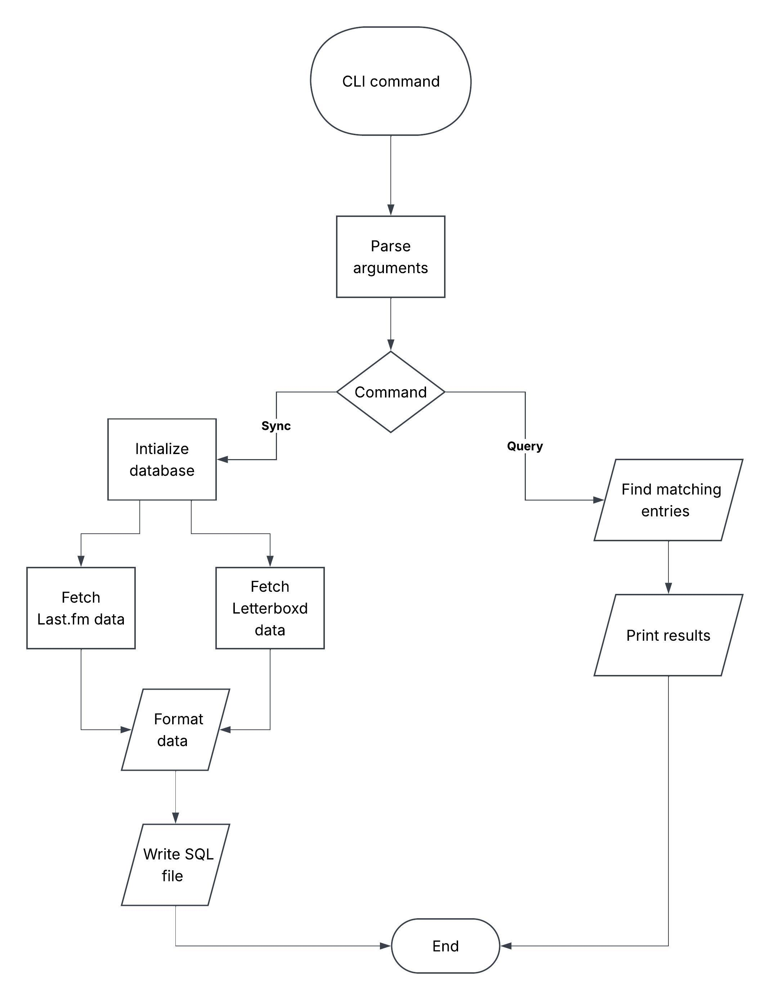

# Media Aggregator
A CLI application that aggregates watched and consumed media from many different sources into one central location. This will include: films, music and books.

## The Problem
The data of different forms of media are scattered across many different apps, making them hard to keep track of.

## How It Works
Users will input the username of their accounts for each platform via the command line. The application will fetch watch and consumption data from each platform. All data will be saved to a database.



## Tech Stack
- **Language:** Python
- **Libraries:** requests, argparse, sqlite3, json, datetime, xml.etree.ElementTree
- **External tools:** Last.fm REST API, Letterboxd RSS Feed

## Setup
```
git clone https://github.com/okoama/media-aggregator
cd media-cli
```

## Roadmap
- [] Expansion to more media types
- [] Advanced queries and trend data
- [] Schedule automatic API refreshes
